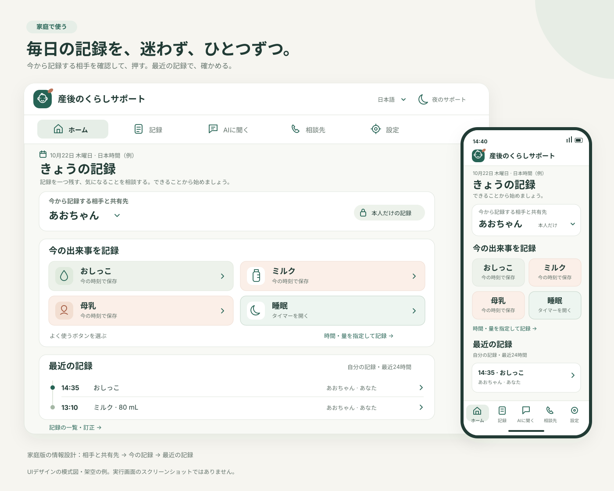
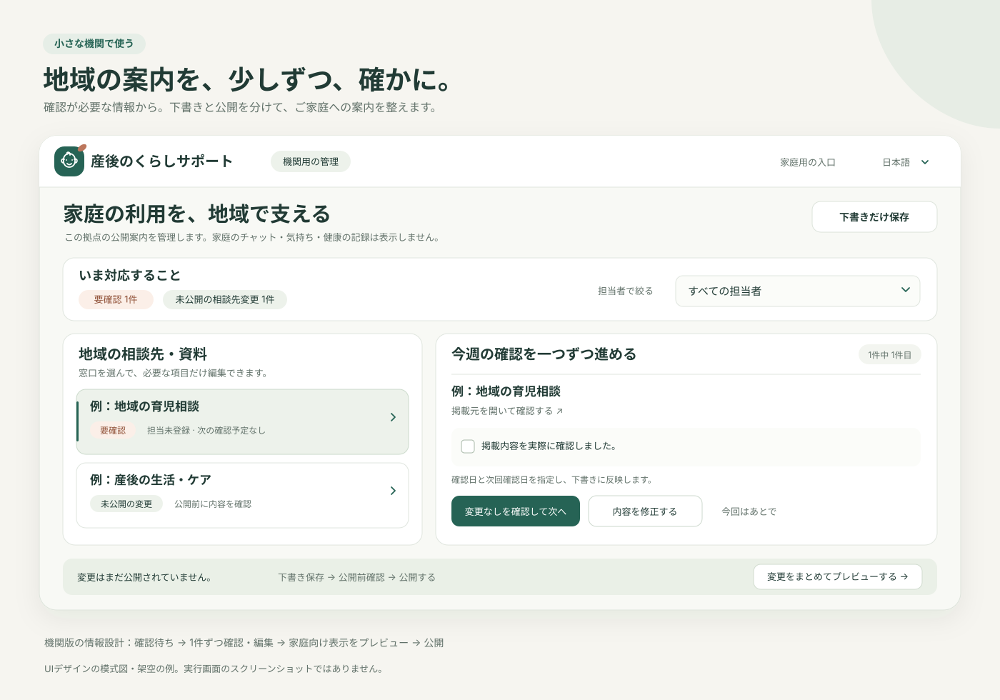

# Postpartum AI Copilot · 産後のくらしサポート

日本の産後家庭と、小さな助産院・地域の支援拠点のための、記録と相談のアプリです。
AIに詳しくなくても、授乳を記録する、困りごとを整理する、相談先を探すところから始められます。

**現在は小規模な試行向けです。** AIの回答には誤りが含まれます。診断・治療・臨床的なリスク判定・救急対応は行いません。
日本で救急車が必要な場合は **119** に直接連絡してください。

### 画面のイメージ · Interface overview

家庭では「相手と共有先 → 今の記録 → 最近の記録」を中心に。小さな機関では、確認が必要な案内から順に整え、公開前に見直せます。

**UIデザインの模式図・架空の例。実行画面のスクリーンショットではありません。**
Design illustrations with fictional examples; these are not screenshots of the running application. Open either image to view the original SVG.

[](docs/assets/family-ui-overview.svg)

[](docs/assets/organization-ui-overview.svg)

配色・余白・文字・ナビゲーションの整理と、図の範囲は[UIの見た目の改善と模式図](docs/product/VISUAL_REFRESH.md)にまとめています。図は構成を伝えるために内容を省略しており、表示・操作の実行確認を示すものではありません。

今回の改善はソース変更の段階です。依頼に従い、アプリの起動、依存関係のインストール、ビルド、テスト、実データでの操作は行っていません。
実際の利用開始前に、[基本機能の変更と未実施の受入確認](docs/product/PRODUCT_IMPROVEMENTS.md)、[7項目の製品改善・移行事項](docs/product/PRODUCT_POLISH.md)、[UI構成の整理と未実施の表示確認](docs/product/UI_REFINEMENT.md)を確認してください。過去の検証結果は今回の動作確認を意味しません。
今回追加した[家族の引き継ぎ・相談の進捗・アカウント対応の仕様と未実施の確認](docs/product/CARE_FLOWS.md)も参照してください。
最新の[日本語・地域サービス向けの改善と未実施の確認](docs/product/JAPANESE_EXPERIENCE.md)では、案内・入力・運営者表示を整えています。地域案内の追加項目を使うため、対応するバックエンドとフロントエンドを一緒に更新してください。
[今回のリポジトリレビュー修正と更新時の注意](docs/security/REPO_REVIEW_FIXES_2026-10-16.md)では、外部AIへの送信、通知の受け取り、運営統計の権限、ログと検索資料の扱いを見直しています。起動・ビルド・テストは未実施です。
[8項目の操作改善と更新事項](docs/product/INTERACTIONS.md)では、その場での記録補足、今日のタイムライン、質問の下書きボタン、ホームの並び替え、確認して保存するタイマー、引き継ぎの版ごとの確認、3段階の相談準備、機関の毎週の確認を追加しています。今回も起動・ビルド・テストは行っていません。
最新の[継続して使うための7項目と移行事項](docs/product/CARE_CONTINUITY.md)では、赤ちゃんの対象指定、日付をまたぐ記録、ホームの続きからの操作、家族の近い記録の確認、相談の終了、機関内の確認待ちの保存、目的別の初回案内を追加しています。**既存の赤ちゃんの記録は対象未設定・本人だけの記録として残り、本人が対象と共有を選ぶまで新しい家族表示には出ません。** 新しいテーブルと列の移行は未実行です。

## 家庭・機関の入口と運営者の管理

最新の[対象・記録整理・交接・相談材料の改善と移行事項](docs/product/WORKFLOW_CLARITY.md)では、対象と公開範囲の共通表示、対象未設定の記録の整理と取り消し、具体的なホームの続き、前回確認後の共有内容の変化、相談ごとの保存材料、AI送信ボタン、運営者の対応一覧を追加しています。相談材料の明示的な保存は7日間の下書き復元とは別で、自分で削除するまで自動では期限切れになりません。3つの新しいテーブルの作成・動作確認は未実施です。

| 入口 | 対象 | できること |
| --- | --- | --- |
| `/` | 初めての方 | 家庭用・機関用の選択、日本の相談先の確認 |
| `/family` | 産後家庭・家族 | 授乳・おむつ・赤ちゃんの睡眠・搾乳・自分の気分や回復の記録、場面から始めるAI相談、相談用の記録のプレビュー |
| `/organization` | 小さな助産院・地域支援機関 | 家庭向けリンクの案内、機関の公開連絡先・受付時間・地域の資料の編集 |
| `/operator` | 設置先の運営者（管理者権限が必要） | アカウント申請の受付・対応状況・返信、運営統計の確認 |

### ご家庭で使う

1. 家庭用の入口で、ご自身のアカウントを作成します。家族でパスワードを共有しないでください。
2. 最初の案内で「記録を始める／家族のお世話に参加する／人に相談する準備」から選べます。プロフィールの入力は任意の別入口で、後から設定できます。記録・確認・修正の練習はホームからいつでも開けます。
3. ホームで「今」の記録と最近の記録を確認できます。詳しい記録、AI相談、相談先にはメニューから移動できます。

スマートフォンでは画面下の「ホーム／記録／AIに聞く／相談先／設定」から移動します。入口の切り替えとログアウトは「設定」にまとめました。
ログイン・初回案内は内容に合わせてスクロールできます。チャットは回答の改行を保ち、複数行で質問を編集できます。
相談先の一覧と相談用紙は切り替えて表示します。電話で話す内容を用紙へ移すと、まず確認欄を表示し、本人が質問欄を選びます。
ホームやヘルプの「相談先を探す」は相談先一覧を開きます。用紙の編集は残り、質問を採用した後は選んだ欄、見送った後は用紙の見出しへ移動します。

記録の保存・読み込みだけでは、入力を外部AIへ送信しません。相談や分析などのAI機能は、外部サービスでの処理について確認してから送信します。
場面のボタンは質問の下書きを作るだけで、自動送信しません。日時と「今日」の集計は日本時間（JST）です。
赤ちゃんの呼び名は本人用に1人、各家族に1人まで登録できます。記録者とは別に対象を選び、対象未設定のまま本人だけで記録することもできます。家族の赤ちゃんを選んでも、その1件の共有と家族設定の共有許可の両方を選ぶまで家族には見せません。氏名・生年月日は不要で、過去の記録を自動で移し替えません。

記録は「今の時刻」または選んだ日本時間で保存し、後から更正・削除できます。補記は日本時間の今日を含む365日間が対象です。
種類を変えても日時と共通メモは残ります。別の画面で変更・削除された記録は、そのまま上書き・削除できません。
削除後は8秒間、元の内容と日時で戻せます。元に戻す処理は別の識別子を持つ記録を作ります。削除の取り消しができるのは、この画面に残っている直近1件だけです。
ホーム、記録、グラフ、相談用の記録は、同じ画面内の記録変更に合わせて更新します。
ホームで「今の記録」と「最近24時間／今日／昨日」のタイムラインを確認できます。「おしっこ」などのボタンは1回押すと保存し、回数・量・時間を推測しません。保存の控えから「時間を直す／量・時間を補う」を開き、変更を確認して保存できます。種類や対象で絞り、押すとスマートフォンの下から詳細と修正を開きます。「自分の記録」と自分で選んだ「家族の共有記録」は別表示で、共有側は確認専用です。「何分前」と正確な日本時間を併記します。
授乳・睡眠は確認した終了時刻を残せます。日付をまたぐ記録も重なる期間に表示しますが、時間をその期間だけに切り分けた集計ではありません。以前の終了時刻がない記録から終了を推測しません。保存後の控えやタイマーから、その記録を直接開けます。
ホームの「続きから」は未確定の保存、入力途中の記録、タイマー、自分で決めた相談の予定を開きます。開くだけでは保存・復元・連絡しません。同じ赤ちゃん・種類の家族の共有記録が5分以内にあると、保存前に確認できます。別の出来事かどうかは本人が判断し、自動で統合・削除しません。この確認の範囲は直近7日間の見える共有記録だけです。
よく使うボタンを1〜4個選び、順番を変更できます。設定はボタンの識別子だけを端末のアカウント別設定に保存します。授乳・睡眠のタイマーボタンは計測欄を開き、自動では記録しません。「開始 → 終了 → 時刻と時間を確認 → 保存」で記録し、中断後は実際の終了時刻を確認します。下書き復元を有効にして保存できたタイマーは、再度開いた後に本人が選んで復元できます。
赤ちゃんのお世話とご自身の体調・気持ちは種類を分けて選べます。母乳は時間・左右、ミルクは量を先に表示します。方法を変えても入力済みの値は補足欄に残り、確認・削除できます。保存、削除、元に戻す、直前の記録の取り消しは別の状態として表示します。
入口・ログインでは公開済みの運営者名を確認でき、問い合わせ方法・受付時間を開けます。未掲載の情報を実在する運営者や専門家の案内として補いません。
「家族の育児の引き継ぎ」は、表示する家族を自分で選びます。共有された直近7日間の赤ちゃんの記録を種類ごとに表示し、未記録・未共有は「不明」と示します。自分の引き継ぎメモは、保存時に家族へ見せるか選べます。取得日時と実際の記録時刻を分けて表示します。
共有メモの「確認しました」は、読んだ版・確認した人・日時を記録します。開くだけでは確認済みにせず、内容が変わった場合は以前の版の確認として表示します。お世話を済ませたことの記録ではありません。
通信に失敗した保存は、最初と同じ内容・日時・保存リクエストで再試行します。別の記録を作る前に一覧を確認できます。操作例は実際の記録に保存しません。

ログイン中のページ切り替えでは、チャット・記録フォーム・相談用紙の下書きとAIの処理状況を保ちます。
画面の再読み込み、画面を閉じる操作、入口の切り替え、ログアウトで画面内の情報は消えます。別のタブでのログアウト・アカウント変更でも画面を消去します。
「設定 → データとプライバシー」で下書き復元を選ぶと、本人のアカウントに保存した入力を再度開いた際に確認・復元・削除できます。初期状態はオフ、復元対象は最後の保存から7日間です。期限を過ぎた内容はアクセス時に消去します。通信前の入力や実行中のAI処理、会話全体の復元は保証しません。
チャットは「この質問の続きを聞く」で、前の質問と回答を確認・選択して今回の送信に付けられます。選ばない場合は過去の会話を付けません。復元時も送信の選択・確認をやり直します。
回答の「もっと短く」「状況を補足する」は編集できる質問の下書きを用意します。前のやり取りの選択・送信内容の確認・同意は毎回必要で、ボタンを押しても自動送信しません。
AIの重要な注意は回答の前に表示し、全文を残します。冒頭の抜粋・今回伝えた情報・追加質問・出典は補足から確認できます。資料のリンクは実際に検索された資料のURL情報だけを使い、AIが書いたURLから作りません。質問・添付資料・今回送る内容・同意を一か所にまとめ、質問の変更後は同意をやり直します。本人が質問を編集・確認してから相談用紙へ移せます。

相談用の記録は、**3・7・14・30日間**から期間を選び、今回聞きたいことを3つまで添えられます。記録がなくても質問だけで準備できます。
相談用紙では赤ちゃんの対象、または対象未設定を選び、その対象について自分が記録した内容を使います。別の対象や家族が記録した内容を自動で混ぜません。
**自分の気分・回復の記録、自由記述のメモ、最新5件の明細は初期状態で除外**します。
記録した回数・睡眠時間と、記録がある日数を示し、未記録を「何もなかった」と扱いません。
プレビューを編集してからテキスト保存、印刷、ブラウザーのPDF保存を選べます。短い内容なら1枚を目安としますが、文章量や印刷設定により複数枚になります。
記録や掲載設定が変わっても編集稿は消しません。最新の用紙を確認するまで印刷・保存を止め、切り替えた後も以前の編集稿を参照・コピー用に残します。
自分用のCSVバックアップは相談用紙とは別に、睡眠の様子を含む全記録項目を列ごとに保存します。
チャットやアカウント情報は自動では含めず、機関へ自動送信しません。
ダウンロードして相手に渡したコピーをアプリから撤回することはできません。

家庭の設定は「プロフィール」「データとプライバシー」「表示」「ヘルプ」にまとめています。
表示では文字サイズ・コントラスト・動きを端末ごとに調整できます。通知を許可した場合、家庭画面を開いて接続している間に、保存済みの通知予定を確認します。ブラウザーが通知を受け付けた後に結果を記録しますが、本人が読んだことを示すものではありません。閉じた画面・オフラインでの配信保証や、自動の授乳時刻提案は行いません。
運営統計は家庭の設定に表示しません。
ホームの「家族との育児の引き継ぎ」から、招待リンク・QRコードまたは各自のアカウントIDで参加できます。参加だけでは共有せず、本人がこの家族に見せる赤ちゃんの記録・自分の気分や回復・自由記入メモを別々に選びます。赤ちゃんの記録には、その家族の対象指定と1件ごとの共有選択も必要です。共有一覧は直近7日間と重なる記録で、記録者を表示します。APIからの取得にも同じ期間制限を適用します。参加状況や共有設定が変わると古い画面からの保存を止め、最新の設定の確認を求めます。招待の取り消し・参加者の権限取り消し・退出に対応し、機関の編集権限には家庭へのアクセスを付けません。
相談先は用途ごとに絞り、名前・対象地域・受付時間・電話／予約を先に表示します。申し込み・準備の詳細は必要なときに開けます。電話で話す内容を編集・コピーでき、相談用紙へ入れる質問は本人が欄を選んで確認します。窓口への自動送信はありません。
ログイン後は「相談先を選ぶ → 話すことを準備する → 次の予定を記録する」の3段階で使えます。各段階を直接開いたり、準備を飛ばしたりできます。窓口の公開された準備事項と、本人が編集する電話の説明を一緒に確認できます。
本人だけが見る「連絡の準備中／返信待ち／予約済み／相談を終えた／今はいったん見送る」、窓口から聞いたこと、自分の次の行動を保存できます。終了・見送りは連絡予定日時を外します。電話や予約リンクを押しても自動で状態を変えません。日時の通知は行いません。窓口の掲載が終わっても、以前の進み具合は別の履歴として確認・消去できます。
家族の招待リンク・QRコードは24時間、1回限りです。ログインして参加を確認するまで加入しません。リンクの発行・取り消しは家族の管理者が行います。共有は参加後も本人が選びます。
ネット接続が戻っても自動では再送信しません。送信前の未送信と、送信後の保存結果が未確認の状態を区別し、一覧を確認して同じ保存を再試行できます。オフライン保存は未対応です。

### 小さな機関で使う

機関の画面で扱うのは、**この設置先の公開案内**です。家庭のチャット・気分・健康記録を一覧表示する機能や、自動で相談を受け付ける機能はありません。
案内リンクを利用しても、家庭の情報が機関に共有されることはありません。

- 運営者が実際のアカウントIDに編集権限を付与します。入口の選択、登録メールアドレス、新規登録だけでは権限を取得できません。
- 機関名、地域、業務用の電話・メール、受付時間、保存期間、AIへの送信とアカウント申請の対応説明を登録できます。
- 地域の資料やサービスは最大10件。HTTPSの情報元・予約リンク、対象地域・対象者、費用・利用条件、電話、受付時間、実際に確認した日を登録できます。
- 利用条件・自己負担・申請と予約の順番・里帰り中の利用案内を、実際に確認して記入できます。未確認の項目は家庭にも未確認と表示します。里帰り案内は任意の公開項目 `visiting_note`（500文字まで）で、住所を収集したり利用資格を自動判定したりしません。
- 相談先ごとに「要確認／未公開の変更／休止」を表示し、電話だけの変更や受付の休止・再開を小さな編集欄から開けます。編集は共通の下書きに残り、下書き保存・公開前確認・公開を経て家庭向けの表示を更新します。下書きと公開中の休止状態は区別して表示します。
- 毎週の確認では、担当者の絞り込みに合う情報を一つずつ確認し、「修正／変更なしを確認／あとで」を選べます。機関内だけの担当・理由・次回確認日を保存し、別のログインでも続けられます。変更なしの確認には実際の確認と日付の指定が必要です。確認・編集時は機関の下書き全体と内部の引き継ぎを一緒に保存し、変更対照のプレビュー・公開は別に行います。延期は内部の情報だけを保存します。閲覧だけでは確認日や公開内容を変えません。
- 産後ケア・地域相談・授乳相談のひな形を使い、公開前に家庭からの見え方を確認できます。ひな形は実在する窓口や確認日を自動で埋めません。
- 窓口を一覧から1件ずつ編集し、公開用の担当名と次の確認日を管理できます。未完成の下書きだけを保存し、後から続けられます。公開履歴の変更点を確認し、以前の版を下書きへ戻してプレビュー後に再公開できます。
- 申し込み手順・準備するもの・代わりの相談先・一時休止と再開の案内を登録できます。担当で一覧を絞り、公開前に現在の公開内容との差分を確認できます。休止中の窓口には予約ボタンを表示しません。
- 編集項目は基本情報・サービスの詳細・維持管理に分けています。下書き保存・公開前確認・公開は別の操作です。入力エラーから対象の窓口と項目へ移動できます。電話番号の全角数字などは保存・確認時に整えます。
- 未保存の変更がある場合、入口の切り替え・ログアウト・ブラウザーの戻る／進むで確認します。キャンセルすれば編集を続けられます。保存済みの機関の下書きは入口を離れても残ります。保存・公開処理中の画面移動は止めます。
- 未確認・確認から30日以上の窓口を一覧にします。担当と公開連絡先を確認し、実際に調べてから確認日を更新してください。
- 家庭入口のQRコードはブラウザー内で生成し、画像保存と短い開始案内の印刷に使えます。外部QRサービス、招待コード、家庭の情報は使いません。
- 登録した案内は、未ログインの方にも公開されます。家庭の個人情報を記入しないでください。

**1回の設置につき1機関・1地域の案内**を想定しています。複数機関のデータを同じ管理画面で分離する仕組みは未実装です。

## 日本の相談先

相談先の基本情報はログインやAIの応答を必要としません。オフライン用ページにも全国向けの案内を掲載しています。
地域の案内の取得、記録の保存、AI相談にはネット接続が必要です。

- **119**：日本の救急・消防。救急対応が必要な場合、AIの返答を待たないでください。
- **#8000**：子ども医療電話相談。受付時間は都道府県により異なります。[厚生労働省の案内](https://www.mhlw.go.jp/stf/seisakunitsuite/bunya/newpage_55223.html)
- **#7119**：受診や救急車について迷うときの相談。実施地域・対象年齢・時間を確認してください。[総務省消防庁の案内](https://www.fdma.go.jp/mission/enrichment/appropriate/appropriate007.html)

地域の産後ケアや保健相談は、自治体・提供機関の最新の案内を登録してください。[こども家庭庁の母子保健情報](https://www.cfa.go.jp/policies/boshihoken)
身近な相談先の整備については、[こども家庭庁の地域子育て相談機関の案内](https://www.cfa.go.jp/policies/kosodateshien/sodankikan)を参照できます。
情報の確認日は、医療専門家による監修や、AI回答の正しさを保証するものではありません。

## データの取り扱い

| データ | 取り扱い |
| --- | --- |
| 個人のプロフィール・ケアの記録 | 認証された本人のアカウントに保存。機関用の編集権限でも他人の記録にはアクセスできません |
| 自分の相談の進み具合 | 本人だけが閲覧・更新。電話や予約リンクから状態を推測しません |
| 赤ちゃんの呼び名・記録の対象 | 本人用の呼び名は本人だけ、家族用は参加中の家族が確認。記録共有には別の選択が必要です |
| 家族への引き継ぎメモ・招待 | メモは本人が共有を選択。招待は1回限りで、サーバーにはリンクのハッシュだけを保存 |
| AIへの入力と選択した資料 | 設定した回答サービスに送信。質問文は、設定に応じてOpenAIの内容確認・資料検索でも処理されます |
| 機関の連絡先・地域の資料 | 公開情報。ログインなしで取得できます |
| 機関内の確認待ち・担当・理由 | 権限のある機関職員だけ。公開案内とは別に保存します |
| 相談用にダウンロードしたファイル | 利用者が共有先と保管方法を判断します |
| アカウント申請 | 運営者だけが連絡メールと受付時の本人情報を閲覧。受付番号の保持者は状況と公開返信を読めます |

**ローカルに設置しても、外部AIへの送信は発生します。完全オフラインのAIアプリではありません。**
運営者は実際の保存期間、AI事業者のデータ処理条件、問い合わせ先、削除依頼への対応方法を説明してください。
登録画面と「データとプライバシー」で、公開された運営者・連絡先・保存期間・処理説明を確認できます。未掲載の内容をアプリが推測して埋めることはありません。
送信前にプロフィール、保護者の記録、自由記入メモなどを選べます。選択の初期値はオフです。名前・メール・アカウントIDは資料に自動では加えません。
自分で入力した文章に個人情報があれば、その文章の一部として送信されます。

ログイン前の「ログインできない」窓口、ログイン後の削除・プライバシー申請で、運営者への依頼と受付番号による進捗確認ができます。
受付番号は進捗を読むための大切な情報です。進捗確認はURLに番号を含めずに送信します。以前のURLによる照会は終了しました。
**受付は本人確認・削除・再設定の実行ではありません。** メールの自動通知や再設定リンクの発行はありません。
運営者は別の安全な手順で本人確認し、実際の処理後に `/operator` で結果を登録します。受付番号と公開返信に、パスワードや健康情報を書かないでください。
運営者は本人確認・実際に完了した手順・作業の管理番号を記録し、次の操作と回答予定を案内します。完了時は処理結果の控えを発行し、削除の場合は残るコピーと保管期間も説明します。この画面自体は復旧や削除を実行しません。作業番号は運営者だけが閲覧し、本人向けの控えには公開する結果だけを載せます。
保存期間の案内を入力するだけでは自動削除は実行されません。セルフサービスの完全削除・パスワード再設定、機関内の細かな担当者管理は未実装です。
生成AIと個人情報については、[個人情報保護委員会の注意喚起](https://www.ppc.go.jp/news/careful_information/230602_AI_utilize_alert/)も参照してください。

## English overview

Postpartum AI Copilot supports small Japanese pilots through two public entrances and a separate operator area:

- **Families:** one-tap care records and undo, explicit household care overviews/handover notes, one-use invitations, safe explicit retries, AI follow-up/context review, editable consultation questions and private human-help progress.
- **Small organizations:** individual contact editing, drafts, publication history/restoration and before/after review, maintainer filters, pause/resume and application/fallback instructions, plus family-entry QR codes. Directory-editing rights do not grant access to families’ private records.
- **Operators:** a separate `/operator` area for manual account/privacy requests, verification/processing attestations, next steps, reply times and completion receipts. These attestations do not execute password resets or data deletion.

Home now puts quick records and recent-record correction before optional family handoff. The menu explicitly separates Ask AI from human help; AI warnings precede full answers and supplementary details expand on demand. First-use profile setup is optional, and the practice exercise has one persistent Home entry. Institution shortcuts edit the existing shared draft without bypassing preview or publication. See [UI changes and pending acceptance](docs/product/UI_FRIENDLINESS.md); this revision has not been run, built or tested.

The [interaction changes](docs/product/INTERACTIONS.md) add inline receipt correction, phone detail sheets, editable answer-action drafts, configurable shortcuts, reviewed timers, versioned handover acknowledgements and guided human help.

The latest [care-continuity improvements and rollout](docs/product/CARE_CONTINUITY.md) add explicit baby attribution and per-record sharing, overnight/24-hour views, Home continuation, soft cross-caregiver duplicate review, private consultation closure, persistent internal institution tasks and task-based onboarding. Historical baby records stay unassigned/private until their owner explicitly chooses attribution and sharing; they no longer appear automatically in family views. Deploy the matching frontend/API together and review the new tables/column migration before use. This source revision has not been run, built, tested or migrated.

The [whole-repository review fixes](docs/security/REPO_REVIEW_FIXES_2026-10-20.md) add permanent session revocation across two-factor changes, body-only account-status lookup, one-baby charts/AI analysis, frozen staff-review revisions, timer correction with the original save key, explicit container model settings and migration-gated worker startup. **Existing sessions must sign in again after the coordinated upgrade.** Source changes and regression fixtures have not been executed.

The [workflow clarity improvements](docs/product/WORKFLOW_CLARITY.md) add visible subject/scope context, explicit organization and atomic undo for old unassigned records, actionable Home items, versioned family-change review, private per-consultation material, explicit AI-send confirmation and an operator action summary. Deploy the matching frontend/API/worker; the three new tables and expanded deletion inventory need authorized acceptance. Explicitly saved consultation material has no seven-day draft expiry. No application/build/test/migration was executed for this revision.

The interface supports Japanese and English. Support contacts target **Japan in either language**.
AI responses are labeled as generated content; rule checks and heuristic scores are not presented as medical certification or clinical confidence.
This is a care companion for everyday support, not a diagnosis, treatment or emergency-response service.

## Run locally · 運営者向けセットアップ

Families do not need API keys or model settings. The operator configures the server once.
You need Python, Node.js/npm, and a configured AI provider for AI features. Dependencies are listed in
[`backend/requirements.txt`](backend/requirements.txt) and [`frontend/package.json`](frontend/package.json).

### 1. Backend

Run from the repository root:

```bash
python3 -m venv .venv
source .venv/bin/activate
python -m pip install -r backend/requirements.txt
cp -n do-not-upload/local/backend.env.example do-not-upload/local/backend.env
python -c 'import secrets; print(secrets.token_hex(32))'
```

Edit the ignored `do-not-upload/local/backend.env`: replace `JWT_SECRET_KEY` with a new random secret and configure your chosen provider's API key.
Do not reuse the example values. Set `AI_PROVIDER` to `openai`, `claude` or `gemini`; use the corresponding API-key field.
Then start the API:

```bash
python -m uvicorn main:app --app-dir backend --reload
```

The default local API address is `http://localhost:8000`. Data, logs and vector stores live under the ignored `do-not-upload/` directory.

### 2. Worker

In a second terminal, from the repository root with the same virtual environment:

```bash
source .venv/bin/activate
python workers/worker.py
```

The default `ASYNC_MODE=true` uses this worker for chat and tracking analysis. Use the same database and provider configuration for the API and worker. A directly started worker checks schema metadata and waits without claiming jobs until the API/deployment migration has completed; it never performs the migration itself.

### 3. Frontend

In another terminal, from the repository root:

```bash
cd frontend
npm install
cp -n .env.example .env.local
npm run dev
```

Open `http://localhost:3000`, then choose `/family` or `/organization`. Authorized operators can open `/operator` directly.
For deployment, set `VITE_API_BASE_URL` to the browser-accessible API URL and rebuild the frontend.
`VITE_ASYNC_MODE` must match the backend's `ASYNC_MODE`.
The source now declares `qrcode` **1.5.4** for browser-only QR generation. It was not installed or executed during this change; the normal dependency installation is still required before building.

### 4. Grant organization access

1. Create and sign in to the intended staff account at `/organization`.
2. Confirm who controls that account. The access-required screen shows its server-generated account ID.
3. Put the actual ID in `INSTITUTION_USER_IDS` in the ignored backend environment file; separate multiple IDs with commas.
4. Restart the API. The staff member can now edit the deployment's public directory.

`INSTITUTION_USER_IDS` is separate from `ADMIN_USER_IDS`. It does not grant system administrator privileges or access to other users' records.
Remove an ID and restart the API to revoke directory editing access. All configured editors manage the same public directory.

### 5. Configure manual account support

1. Verify the operator's account and add its actual ID to `ADMIN_USER_IDS`, then restart the API. This grants broader administrator access; do not add all institution staff.
2. Publish the actual responsible operator, contact channel, response time, verification method, retention and AI processing description through the public directory.
3. Open `/operator`, handle requests oldest first, verify identity outside the public reply, and perform any approved reset or erasure through your controlled operational process.
4. Record only the non-sensitive outcome and next steps. Changing request status does not change credentials or erase stored records.

Use the [manual support procedure and data inventory](docs/product/PRODUCT_IMPROVEMENTS.md), [workflow/store additions](docs/product/CARE_FLOWS.md) and [care-subject/internal-task inventory](docs/product/CARE_CONTINUITY.md#manual-privacydeletion-inventory) when preparing operations. There is no automated deletion runner in this change.

### Docker / hosted deployment

Set a unique, URL-safe `POSTGRES_PASSWORD` in the ignored environment file before starting Compose (for example, generate it with `openssl rand -hex 32`). A missing/empty value stops startup. PostgreSQL is available only on the internal container network; its port is not published on the host.
For an existing PostgreSQL volume, changing this variable does not rotate the database password: coordinate the actual credential rotation and API/worker configuration through the operator's database procedure. Keep the existing volume and backups.

```bash
docker compose --env-file do-not-upload/local/backend.env up -d --build
```

Compose starts PostgreSQL, runs the one-shot `migrate` service, starts the API after migration succeeds, and starts the worker after the API health check succeeds. API and worker both receive `OPENAI_MODEL`, `OPENAI_EMBEDDING_MODEL`, `CLAUDE_MODEL` and `GEMINI_MODEL` from Compose interpolation. Stop old workers during upgrades and retain the database volume; see [upgrade notes](docs/security/REPO_REVIEW_FIXES_2026-10-20.md#coordinated-upgrade). Compose does **not** serve the frontend. Build and host the frontend separately:

```bash
cd frontend
npm run build
```

Configure your web server to serve `index.html` for `/family`, `/organization` and `/operator`, use HTTPS, and set the API's `CORS_ORIGINS` to the actual frontend origin.
For real pilots, configure non-example database credentials, back up the database and test restoration. AI spending limits and account recovery remain operator responsibilities.
See [setup](docs/deployment/SETUP.md), [deployment](docs/deployment/DEPLOYMENT.md) and the [Japan pilot guide](docs/product/JAPAN_PILOT.md).

## Architecture and APIs

React/Vite/i18next → FastAPI → SQLAlchemy (SQLite locally, PostgreSQL with Compose).
Background workers process AI tasks through OpenAI, Claude or Gemini.

| Endpoint | Access | Purpose |
| --- | --- | --- |
| `GET /api/pilot` | Public | Public contact details and local resources; no family data |
| `GET /api/pilot/organization` | Institution allowlist | Load directory for editing |
| `POST /api/pilot/organization` | Institution allowlist | Validate and save public information |
| `POST /api/tracking/entries/{id}/update`, `DELETE /api/tracking/entries/{id}` | Authenticated owner | Correct or delete only the caller's record |
| `GET /api/tracking/{user_id}/daily-summary`, `GET /api/tracking/{user_id}/weekly-summary` | Authenticated owner | Current local JST counts; no external AI call |
| `GET /api/notifications/due`, `POST /api/notifications/{id}/acknowledge` | Authenticated owner | Read due reminder IDs and report browser acceptance; no automatic worker completion |
| Product/global task/NPS statistics | Admin allowlist | Operational statistics; own user-path and usage statistics remain owner-scoped |
| `POST /api/pilot/account-help`, `POST /api/pilot/account-help/status` | Public; status requires a random reference in the JSON body | Receive sign-in help and look up a status without account enumeration; legacy GET lookup returns 410 |
| `GET /api/tracking/{user_id}/summary`, `POST /api/tasks` with `tracking_analysis` | Authenticated owner | Analyze one selected accessible baby, or unassigned records by default; adult health remains a separate opt-in |
| `GET /api/account/requests`, `POST /api/account/requests` | Authenticated owner | Own account/privacy requests |
| `GET /api/admin/account-requests`, `POST /api/admin/account-requests/{reference}` | Admin allowlist | Private support queue and public replies |
| Existing tracking / context / chat APIs | Authenticated owner | Personal data and AI requests |

The `pilot_profiles` and new `account_requests` tables use the existing startup table-initialization mechanism. Tracking records now have an immutable `record_key` and an incrementing `revision`. API initialization includes an idempotent SQLite/PostgreSQL migration that backfills identities on existing records without changing their care content. Updates/deletes require both values from a fresh read; outdated clients receive validation/conflict errors rather than overwriting records. Start workers only after API initialization has finished. No application startup or migration was executed during this edit; migration validation remains pending.

The latest polish phase additionally registers record-save receipts, account draft preferences/content and institution workspaces/publication history. The migration adds `family_members.revision` and unique family membership enforcement, and fails rather than silently merging any legacy duplicates. Family sharing writes require the member revision from a fresh read; shared-data requests accept only 1–7 days. Institution mutation bodies require a workspace revision. See [rollout and pending acceptance](docs/product/PRODUCT_POLISH.md#database-and-rollout); deploy frontend/backend together after later authorized validation.
The care-flow revision adds five tables for handovers, invitation hashes, private help progress, operator workflow attestations and status events through existing startup initialization. It adds no columns to existing tables. Deploy the matching API, worker and frontend together; table creation and acceptance have not been executed. See [CARE_FLOWS](docs/product/CARE_FLOWS.md) for API contracts, manual execution boundaries and the expanded erasure inventory.
The interaction revision adds `family_handover_acknowledgements` and the optional `timer` server-draft kind, without changing existing columns. Add acknowledgement rows for both readers and authors, and timer drafts, to manual account erasure. See [INTERACTIONS](docs/product/INTERACTIONS.md#api-and-rollout) for API details and pending acceptance. No table creation was executed.
The current continuity revision adds `care_subjects` and private `directory_review_tasks`, plus tracking subject/end/sharing columns and private support-response/next-step columns. Existing baby records keep no assigned subject and `family_shared=false`; an owner must explicitly assign and share a record before it appears in family views. Review [CARE_CONTINUITY](docs/product/CARE_CONTINUITY.md#api-and-storage-rollout) for the coordinated upgrade and expanded manual erasure inventory. These migrations have not been executed.
The latest review adds `users.session_revision`, initially 1, to the same serialized SQLite/PostgreSQL migration. Access and refresh tokens must include the current positive revision. Enabling/disabling two-factor authentication increments it; turning the factor off cannot restore an earlier session. Old tokens without the claim are rejected. Migration, Compose ordering and re-login behavior still require authorized acceptance.
The scope flags and legacy API limitations are documented in [the change guide](docs/product/PRODUCT_IMPROVEMENTS.md).
The [repository review fixes](docs/security/REPO_REVIEW_FIXES_2026-10-16.md) describe the new notification receipt contract, fresh profile reads, bounded authentication refresh, private error diagnostics and the separate curated RAG collection. Existing vector collections are retained but no longer queried; approved public sources need explicit re-ingestion. Deploy the matching frontend/API/worker together. No database migration or source re-indexing was executed during these edits.

## Verification

**Not run for this change:** application/worker startup, dependency installation, build, lint/parser/compile checks, tests, database migration, vector ingestion and browser/print/QR acceptance. Source review, Git whitespace checks and the read-only publication privacy scan were performed for the repository-review fixes. The commands below are instructions for a later authorized verification session, not evidence that this revision passes runtime acceptance.

```bash
python -W ignore tests/regression/japan_pilot_checks.py
node --test tests/regression/japan_pilot.test.cjs
python -W ignore tests/regression/security_checks.py
python -W ignore tests/regression/followup_checks.py
python -W ignore tests/regression/review_235a4c9_checks.py
node --test tests/regression/frontend_security.test.cjs tests/regression/frontend_tasks.test.cjs tests/regression/frontend_review.test.cjs
node --test tests/regression/review_3961c93.test.cjs
python -m unittest discover -s tests/privacy -v
./check-privacy.sh
```

The offline regression scripts use controlled authentication/provider fixtures; they do not validate live AI providers or clinical accuracy.
The JSX harness executes transpiled component handlers with controlled React hooks. If TypeScript is already installed elsewhere, set `REVIEW_TYPESCRIPT_PATH` to its module path.
Production build, browser and full integration checks require their corresponding installed dependencies. See the [pilot guide](docs/product/JAPAN_PILOT.md) for validation scope and manual acceptance steps.

## Documentation and license

- [Japan pilot guide](docs/product/JAPAN_PILOT.md): scope, access, privacy and acceptance scenarios.
- [Architecture](docs/ARCHITECTURE.md) · [Project structure](docs/PROJECT_STRUCTURE.md) · [Testing](docs/testing/TESTING.md).
- [Security review fixes](docs/security/SECURITY_FIXES_2026-10-10.md) · [Local-only files](do-not-upload/README.md).
- Run `./check-privacy.sh` before publishing. Secrets, live contact information and real family data belong in ignored runtime files, not Git.
- [Apache License 2.0](LICENSE) · [Contributing](CONTRIBUTING.md).
