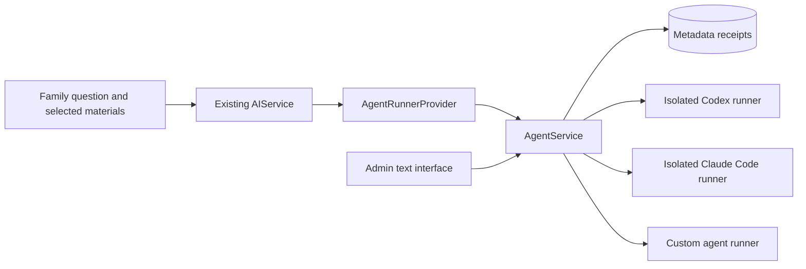

# Family AI providers and Agent interfaces

The existing family AI questions can use `AI_PROVIDER=codex`, `claude_code`, or a custom `agent` runner. The deployment operator selects and configures the provider; families continue using the current question, materials-selection and send-confirmation screens. This does not add a family-facing CLI console, tools, files, autonomous actions or provider-key settings.

`AgentRunnerProvider` implements the existing `AIProvider` contract. It receives `AIService`'s already constructed system messages, selected profile/records, optional previous exchange and retrieved public-source context. It does not fetch additional family data. Answers return to the existing input/output checks, suggestion buffer and presentation pipeline. These checks do not establish clinical accuracy or qualify a model for medical use. No runtime/provider acceptance has been performed.

There is also a separate optional operator API for explicit text submissions and metadata lookup. Those `/api/agents/*` routes require `ADMIN_USER_IDS`; families use the existing chat/task routes instead.

## Architecture



- Provider: `core/services/ai_providers.py`; scoped identity: `core/services/agent_execution.py`; gateway: `core/services/agent_service.py`; optional operator routes: `backend/api/agent_routes.py`.
- `AgentRunDB` records owner, request/run IDs, backend, status, timestamps and a bounded active slot. It stores no prompt, instructions, answer or content hash.
- The API/worker gateway makes one HTTP attempt to a fixed server-configured endpoint and never launches a CLI. Household tasks retain their existing queue, with agent failures explicitly excluded from automatic requeue. There is no provider fallback.
- The optional [reference runner](../../integrations/agent_runner/README.md) implements Codex and Claude Code adapters in a separate non-root Linux service. Its Docker build context is only `integrations/agent_runner/`; its provider credentials belong to that service, not the care API.
- `agent` is an extension point for a separately deployed runner using the same protocol. The stock CLI runner does not accept `backend: "agent"`. Tool/file workflows require a separately reviewed implementation; the supplied adapters expose text requests.

## Configuration

All main-API configuration is validated by `backend/config/settings.py`. Empty URL/token values mean unconfigured, including in default Compose installations.

| Variable | Default / meaning |
| --- | --- |
| `AI_PROVIDER` | `openai`; additionally accepts `codex`, `claude_code`, `agent` |
| `AGENT_ENABLED` | `false`; runner providers and operator submissions require explicit enablement |
| `AGENT_CODEX_RUNNER_URL`, `AGENT_CODEX_RUNNER_TOKEN` | Full Codex execution endpoint and shared secret |
| `AGENT_CLAUDE_CODE_RUNNER_URL`, `AGENT_CLAUDE_CODE_RUNNER_TOKEN` | Full Claude Code execution endpoint and shared secret |
| `AGENT_CUSTOM_RUNNER_URL`, `AGENT_CUSTOM_RUNNER_TOKEN` | Full custom `agent` execution endpoint and shared secret |
| `AGENT_TIMEOUT_SECONDS` | `120`; allowed range 5–300 seconds |
| `AGENT_MAX_OUTPUT_CHARS` | `20000`; allowed range 100–20,000 characters |
| `ADMIN_USER_IDS` | Comma-separated account IDs provisioned by the operator |

Only the backend(s) in use need an endpoint/token pair. Endpoint URLs include the execution path, for example `https://runner.example.invalid/v1/execute`; the gateway does not append a path. HTTPS is required, except exact loopback HTTP when `DEBUG=true`. Embedded credentials, query strings and fragments are rejected. Redirects and inherited HTTP proxy settings are disabled. Runner secrets must be random printable ASCII without spaces, at least 32 characters; the reference runner supports up to 512. Store actual values in ignored runtime configuration or infrastructure secrets.

For example, set `AI_PROVIDER=claude_code`, `AGENT_ENABLED=true`, and configure `AGENT_CLAUDE_CODE_RUNNER_URL` plus its token in the ignored application configuration. Put `ANTHROPIC_API_KEY` only in that isolated runner. For Codex, select `AI_PROVIDER=codex` with the Codex endpoint/token and put `CODEX_API_KEY` only in its runner. A custom `agent` uses the custom endpoint/token and must implement the protocol below. A selected runner provider fails initialization if disabled or missing its endpoint/token; it never silently selects another provider.

Compose passes runner settings to the API and worker, not the migration container. It does not deploy a CLI runner or place one on the care application's network. See the reference runner's deployment contract for filesystem, ingress, egress, process and resource isolation. The supplied Dockerfile alone does not enforce those runtime restrictions or provide TLS. Put the runner behind a restricted TLS endpoint. API and worker must use matching provider settings. Drain or explicitly resolve pending work before switching providers; new tasks carry a server-owned provider snapshot and a mismatched worker refuses to send them. Legacy tasks without that snapshot are rejected when selecting a runner provider.

The snapshot records the backend name, not an endpoint, model or upstream account. Apply the same queue-drain and disclosure review before changing a runner's address/model/upstream behind that name.

The public privacy information identifies Codex/OpenAI, Claude Code/Anthropic or the operator-configured agent and its relay. Fill in the public operator profile's `ai_data_notice` with the actual runner operator, upstream service, processing/retention terms and contact. A custom agent's generic label cannot identify an undisclosed upstream. RAG can still separately use OpenAI embeddings; switching the answer provider does not remove that processing. Keep its disclosure and key, or disable `RAG_ENABLED` if not using it. CLI backends do not claim OpenAI moderation: that existing optional external check only runs for the direct OpenAI provider.

Deploy and qualify the selected exact CLI version before enabling a backend. Unsupported flags fail closed; there is no retry with broader CLI permissions. Codex's read-only and disabled-tool settings do not prove that every tool is unavailable; keep all application/host files and internal services outside the runner's reach. Claude Code uses bare mode with tools disabled. These constraints follow the [Codex non-interactive contract](https://learn.chatgpt.com/docs/non-interactive-mode), [Codex CLI options](https://learn.chatgpt.com/docs/developer-commands?surface=cli), [Codex configuration](https://learn.chatgpt.com/docs/config-file/config-reference), and [Claude CLI reference](https://code.claude.com/docs/en/cli-reference).

## Family execution and retry boundaries

System messages are passed as `instructions`; ordered user/assistant messages are preserved in fixed `postpartum.conversation.v1` JSON as `prompt`. The reference runner replaces the coding assistant's base instructions using a private temporary system file (`model_instructions_file` for Codex, `--system-prompt-file` for Claude). The file exists only in the call's bounded scratch area and is removed after process cleanup; deploy that area on tmpfs. Family text is not embedded in CLI arguments. The adapters do not silently truncate safety instructions or selected materials. The combined conversation must fit 64,000 characters and system instructions 16,000, otherwise dispatch fails without switching providers. CLI output is character-bounded; API-style `temperature` and exact `max_tokens` semantics are not implemented.

The call scope is a `ContextVar` containing only the authenticated account ID and a request UUID. No user state is kept on shared service instances. A worker derives a stable UUID from its persisted task ID and owner, independent of backend. All executions of that same task use the same durable gateway reservation, including across restarts; failed agent tasks are marked terminal instead of automatically requeued. The provider also performs no HTTP retry or fallback. Synchronous routes use a fresh server-generated scope. Streaming waits for the entire answer and existing checks, then emits one `chunk` and `done`; it is not live token streaming.

The shared web client gives synchronous chat, crisis, emotional check-in, AI tracking-summary and operator execution requests a bounded 330-second wait, covering the runner's maximum 300-second execution setting. Caller cancellation/explicit shorter timeouts still apply. Ordinary data requests and task creation keep their 30-second default; this does not introduce automatic resubmission or extend a queued task's execution lease.

This guarantees one dispatch per stored task/request reservation, not one submission forever. A family member's manual resend creates a new task; a new synchronous request also has a new scope. Cancellation or a timed-out task is not proof that an external call stopped. A per-account active slot lasts at most the execution timeout plus 30 seconds; expiry marks unresolved work `unknown` and releases the slot without replay. Handle an uncertain outcome before submitting equivalent work. The existing family task store still retains its questions and processed results; execution-receipt `output_retained:false` does not override that storage.

## Optional operator API

These routes require the existing bearer access token and admin authorization. Rate limits apply. Capability/status reads do not call a model or probe a runner. Responses use `Cache-Control: no-store`. Ordinary family accounts cannot use them.

| Endpoint | Result |
| --- | --- |
| `GET /api/agents/capabilities` | Enablement, protocol, per-backend configuration presence and limits; no URLs, credentials or models |
| `POST /api/agents/runs` | One confirmed request and its receipt; answer text only in a successful original response |
| `GET /api/agents/runs/{run_id}` | This operator's receipt only, never answer text; another owner's run returns 404 |
| `GET /api/agents/requests/{request_id}` | Read the same owner-scoped metadata by the client's request ID after a lost response, without dispatch |

Example POST body (synthetic text and ID):

```json
{
  "backend": "codex",
  "request_id": "00000000-0000-4000-8000-000000000001",
  "prompt": "Summarize this synthetic interface proposal in three points.",
  "instructions": "Use concise Japanese.",
  "confirmed": true
}
```

The schema rejects unknown fields, blank prompts, non-string text and non-boolean confirmation. `backend` must be `codex`, `claude_code` or `agent`; `request_id` must be a UUID. Prompt length is 1–12,000 characters, instructions at most 4,000, and text must be valid UTF-8. A disabled or unconfigured backend returns 503; invalid input returns 422. Confirmation is an API contract, not proof of a human review; a future UI must implement its own visible review step.

Successful example:

```json
{
  "run_id": "00000000-0000-4000-8000-000000000002",
  "request_id": "00000000-0000-4000-8000-000000000001",
  "backend": "codex",
  "status": "completed",
  "created_at": "2026-11-01T12:00:00Z",
  "finished_at": "2026-11-01T12:00:04Z",
  "output_retained": false,
  "output": "A synthetic answer."
}
```

Receipts can be `reserved`, `running`, `completed`, `failed` or `unknown`. `failed` includes the fixed code `AGENT_RUN_FAILED`; `unknown` includes `AGENT_RESULT_UNKNOWN`. Neither returns runner diagnostics or output. A POST can return HTTP 200 with a non-completed status; inspect `status`, not only the HTTP code. Answer text is delivered only once in the original successful POST, never retained or replayed by this application or reference runner. If that response is lost, a completed receipt cannot recover the answer.

### Request IDs and uncertain results

Generate one random request ID when preparing an operator submission and keep it while checking that operation. The database commits a reservation before any outbound call. Reusing an ID, even with a different backend or body, returns 409 and the existing receipt without another dispatch. A unique active slot prevents simultaneous dispatches by one account across API/worker instances.

The existing HTTP error wrapper places the agent conflict `{code, message, run}` in `error.message`. Codes are `AGENT_REQUEST_ALREADY_RESERVED`, `AGENT_RUN_ACTIVE` and `AGENT_RUN_STATE_CHANGED`. The shared JS client exposes the allowlisted conflict as `error.code` and `error.agentRun` so callers can use `getAgentRun(error.agentRun.run_id)`. It does not retain arbitrary response details.

`frontend/src/utils/api.js` provides `getAgentCapabilities()`, `runAgent(payload, options)`, `getAgentRun(runId)` and `getAgentRunByRequest(requestId)`. The submission helper allows up to 330 seconds by default, covering the server's maximum execution timeout. It does not generate request IDs or retry execution failures. Existing authentication refresh can repeat an authentication-rejected request using its unchanged ID. Aborting a browser request stops waiting; it is not a remote cancellation API.

Network errors, timeout, malformed/mismatched responses, non-200 runner responses and unexpected dispatch errors become `unknown`. Do not automatically create a new ID to repeat the work. Keep the original client request ID and check `GET /api/agents/requests/{request_id}` if the run ID was lost. A 404 means no receipt is currently visible to this owner; it does not prove an original request still in transit can never arrive. Do not use POST as a status lookup: if no reservation exists, it starts work. A per-operator slot remains reserved for at most the configured timeout plus 30 seconds. Expiry marks unresolved work `unknown` and releases the slot; **it does not establish that a remote process has stopped**. Resolve uncertain execution operationally before starting equivalent work. No cancel, resume, session continuation or background result-retrieval endpoint is supplied.

## Runner protocol and extension point

The gateway sends `Authorization: Bearer <configured secret>` to the full endpoint with:

```json
{
  "protocol": "postpartum.agent.v1",
  "request_id": "00000000-0000-4000-8000-000000000002",
  "backend": "agent",
  "prompt": "Explicitly confirmed text",
  "instructions": "Optional instructions",
  "timeout_seconds": 120,
  "max_output_chars": 20000
}
```

This runner `request_id` is the **server run ID**, distinct from the family scope/operator request ID. Use it as a durable reservation key before starting work. Prompt length is at most 64,000 characters and instructions 16,000; the operator HTTP submission schema intentionally has the narrower 12,000/4,000 limits above. A custom runner must authenticate the shared secret, reject unexpected fields and unsupported backends, honor size/time limits, prevent repeated execution of an ID across restarts, avoid logging/retaining content, apply the application's trusted system instructions and constrain its own tools and data access. It must not follow model-supplied commands, paths or endpoints without a separately designed execution policy.

Return HTTP 200 with matching `protocol`, `request_id`, `backend`, and `status`. `completed` requires a nonblank UTF-8 string `output` within the requested limit. `failed` has no output; `unknown` represents uncertain execution. Optional `error.code` is private to the runner and is not forwarded as a diagnostic. The gateway accepts no redirects/compressed response bodies and caps the streamed response size. Non-200 responses conservatively establish no terminal execution result.

The reference runner passes prompt/conversation text on stdin to a fixed CLI binary, with no shell interpolation. Each call has a fresh scratch home/workspace and a small allowlisted child environment. It bounds both output streams, checks terminal CLI events, kills/reaps the Linux process group on exit/timeout/disconnect/cancellation, and removes scratch files afterward. It stores only durable request metadata in SQLite. Its duplicate protection requires exactly one service instance, one Uvicorn worker and persistent state; horizontal replicas with separate SQLite files are unsupported. See [runner documentation](../../integrations/agent_runner/README.md) for the full contract and limitations.

## Privacy and rollout

Selected materials pass through the gateway/runner to the chosen model provider. Provider processing and retention depend on the operator's account terms; this change does not override those terms. Keep proxy/APM body capture and CLI/session logging disabled. The runner's temporary system file is private scratch data, not a retained session. Existing household task data and processed results remain stored under their existing policy. The additional main database receipts keep owner-linked execution metadata; the reference runner keeps request IDs/status/timestamps, including reservations after a restart. These are not anonymous data. Add both metadata stores, temporary processing and backups to the [manual erasure inventory](../product/CARE_CONTINUITY.md#manual-privacydeletion-inventory). Do not erase duplicate-prevention records to retry uncertain work. No automatic metadata expiry, account-erasure executor or agent export endpoint is added.

The change adds the `agent_runs` table and its unique owner/request and active-owner constraints through the existing `init_db()` table creation. There are no new columns on existing tables. Apply the coordinated API/worker/deployment revision and complete schema initialization before workers claim jobs: the worker's schema gate includes this table even while agents are disabled. This edit has not created a database table or run a migration. Keep `AGENT_ENABLED=false` until authorized isolated acceptance is complete.

Source and contract review covered routes, configuration, database reservations, ownership, bounded transport, fixed CLI arguments, stream parsing and cleanup. No application/runner/CLI startup, dependency install, Docker build, lint/parser/compile check, migration, model call or test was performed. Runtime acceptance remains pending:

- Authenticated owner/admin boundaries, institution-only denial, disabled/missing configuration, strict confirmation, unknown fields and invalid UTF-8.
- Existing family materials selection and confirmation, ordered previous exchange, Japanese system replacement, full answer checks before streaming, provider/relay disclosures and separate RAG processing.
- Worker stable IDs across restart, no automatic agent requeue, task/provider snapshot mismatch, missing legacy snapshot, synchronous/manual-resend limits and absence of cross-account context state.
- Same-ID and concurrent-operator races, cross-owner lookup by both IDs, lost response followed by read-only request-ID lookup, database failure before dispatch and process restart after reservation.
- Runner success/failure/unknown, wrong request/backend/protocol, redirects, compressed/oversized/malformed output and total timeout.
- Pinned CLI flag compatibility, missing provider credentials, provider rejection, truncated terminal events, output overflow, disconnect/cancellation and process/scratch cleanup.
- Filesystem/egress denial, persistent SQLite duplicate protection after restart, and no application data, prompts, answers or credentials in proxy, service, CLI persistence or telemetry logs.

Use synthetic text for that later acceptance session. Publication source/whitespace/privacy checks are not runtime validation.
